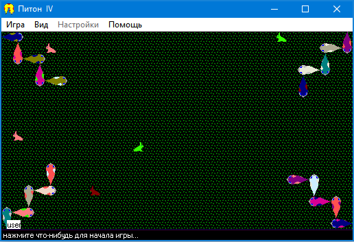
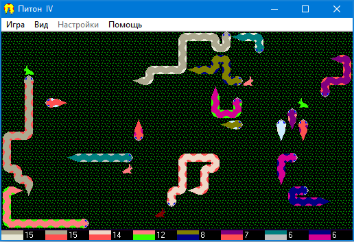
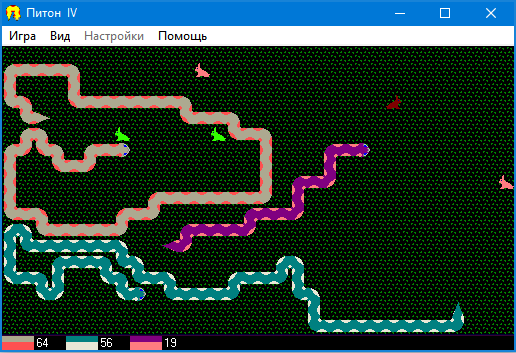
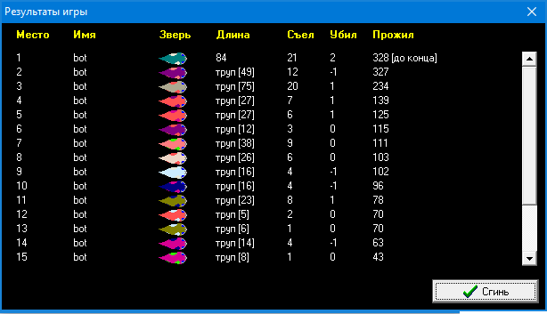
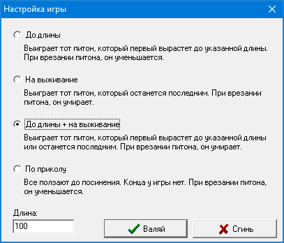
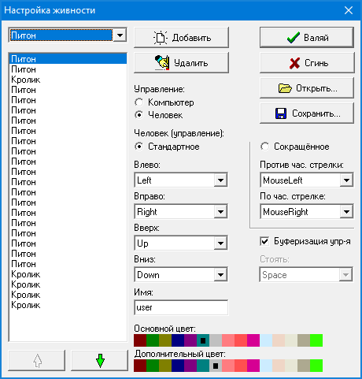
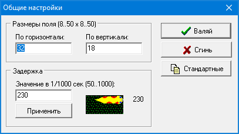
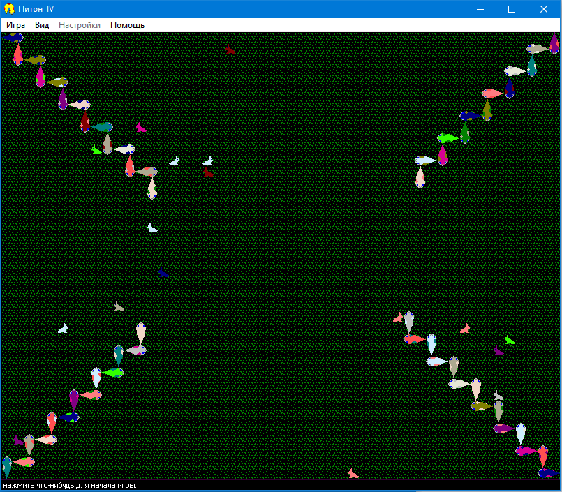
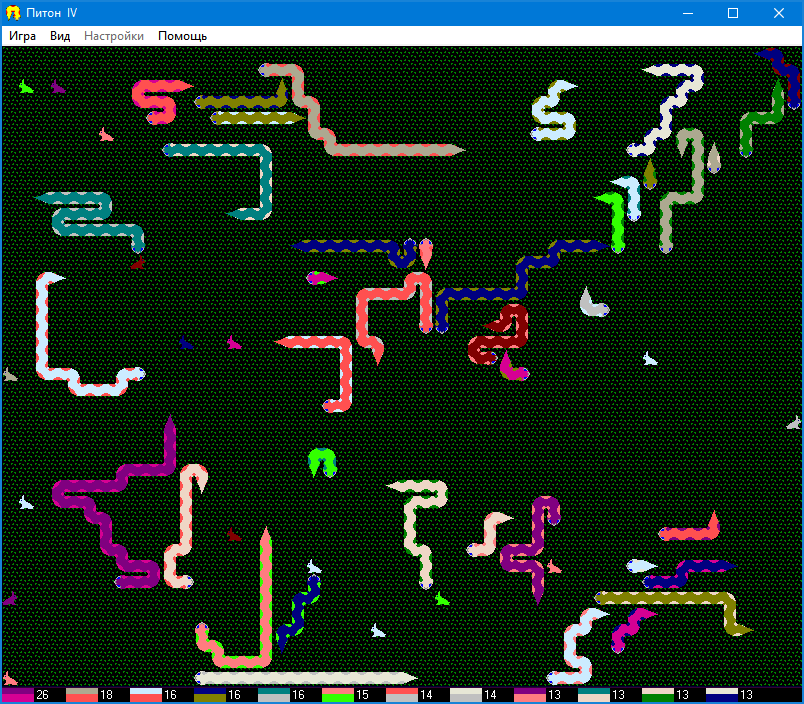
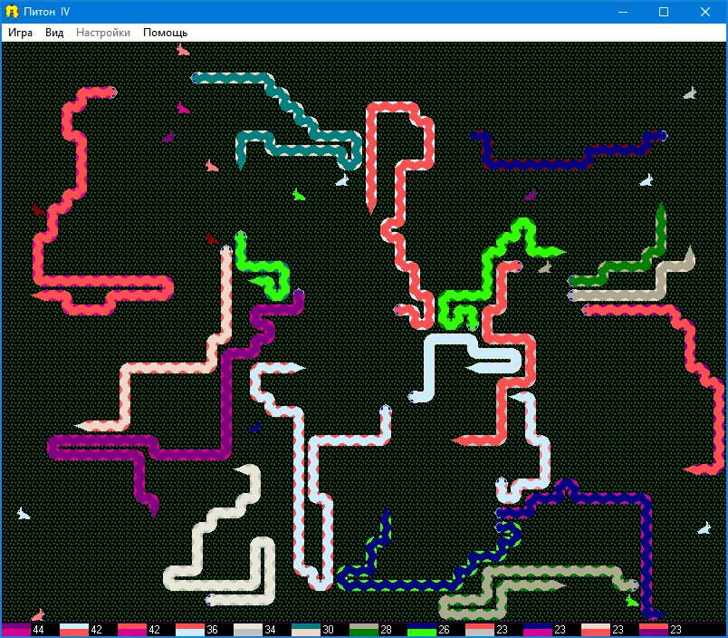

## Питон 4

* **Год написания:** 1999
* **Среда разработки:** Delphi 5
* **Статус:** Архив

Четвертая игра по типу "Змейка". Первые три были еще в эпоху MS-DOS. Данная версия - "мультиплеерная". Надо бороться с другими питонами за выживание и размер. Количество питонов и кроликов может быть большим. Надо гоняться за кроликами, поедать их, расти, не врезаясь в других питонов и стенки. Есть несколько режимов игры – см. скриншоты.

Игра была сделана в эпоху Windows 9x (Windows 95, 98). Там даже есть сетевая игра с запуском сервера и присоединением к серверу. Однако это сделано на каких-то компонентах, которые работают только под Windows 9x. На самом деле я сильно удивился, когда в 2026 году увидел это, поскольку я вообще не помню, чтобы я что-то такое делал. Надо проверить это на работоспособность. 

В версии для Windows 9x есть какие-то проблемы с изменением цвета игровых персонажей (питонов и кроликов). Но была обнаружена версия, измененная и скомпилированная для Windows NT. Там все нормально с цветом, но сетевая игра задизаблена. Играть можно только с ботами. На современных компьютерах запускать надо именно ее.

Играть можно и за кролика. 

Скачать можно в [разделе релизов](./../../releases).

Скриншоты:

* 
* 
* 
* 
* 
* 
* 
* 
* 
* 
